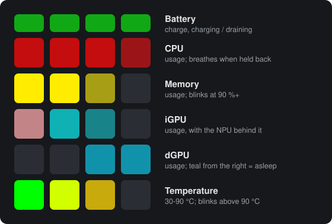

# Framework 16 RGB Macropad: system monitor (sysmon)

This branch of a [QMK firmware](https://qmk.fm) fork turns the **Framework
Laptop 16 RGB Macropad** into a live system monitor. Each of the pad's six key
rows becomes a bar graph: battery, CPU, memory, iGPU (with the NPU), dGPU and
temperature. The pad also tells you when a limit holds your CPU or GPU back,
and scrolls its name across the keys: `CPU STAPM 28W`.

It has two parts: the **sysmon firmware** on the macropad, which draws, and
the **FW16 Macropad Sysmon** Windows service, which measures, decides and
sends.

## User manual

**[Read the manual →](/keyboards/framework/macropad/keymaps/sysmon/manual/README.md)**

1. [Reading the pad](/keyboards/framework/macropad/keymaps/sysmon/manual/01-reading-the-pad.md): every row, the bars, the brightness, the rhythms
2. [Limits and messages](/keyboards/framework/macropad/keymaps/sysmon/manual/02-limits-and-messages.md): why a row breathes, what the scrolling text means, the replay key
3. [What the pad shows, and when](/keyboards/framework/macropad/keymaps/sysmon/manual/03-what-the-pad-shows-when.md): the boot rainbow, sleep, shutdown, crashes, lights off
4. [Keys and lighting controls](/keyboards/framework/macropad/keymaps/sysmon/manual/04-keys-and-lighting.md)
5. [The host program](/keyboards/framework/macropad/keymaps/sysmon/manual/05-the-host-program.md): the service, Start menu, files, live view, log, command line
6. [Settings](/keyboards/framework/macropad/keymaps/sysmon/manual/06-settings.md): `sysmon.ini`, recipes, every setting
7. [The limit log](/keyboards/framework/macropad/keymaps/sysmon/manual/07-limit-log.md): the long-term record of what held the CPU and dGPU back
8. [Troubleshooting](/keyboards/framework/macropad/keymaps/sysmon/manual/08-troubleshooting.md)
9. [Installing, updating, flashing, removing](/keyboards/framework/macropad/keymaps/sysmon/manual/09-install-update-remove.md)
10. [FAQ, limitations and glossary](/keyboards/framework/macropad/keymaps/sysmon/manual/10-faq-and-glossary.md)

## For developers

- [Technical reference](/keyboards/framework/macropad/keymaps/sysmon/readme.md):
  the wire protocol, building the firmware and the installer, running the host
  from source, the animation preview and LED trace tools.
- Firmware: [`keyboards/framework/macropad/keymaps/sysmon/keymap.c`](/keyboards/framework/macropad/keymaps/sysmon/keymap.c)
- Host: [`keyboards/framework/macropad/keymaps/sysmon/host/`](/keyboards/framework/macropad/keymaps/sysmon/host/)

## The rest of this repository

Everything outside `keyboards/framework/macropad/keymaps/sysmon/` (and this
file) is QMK firmware as Framework ships it for the Laptop 16's input modules.
See QMK's own [readme](/readme.md) and [documentation](https://docs.qmk.fm).
