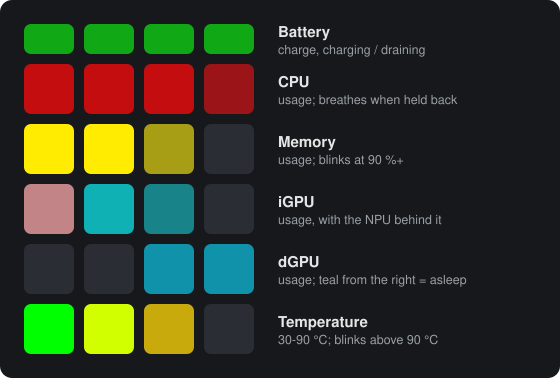
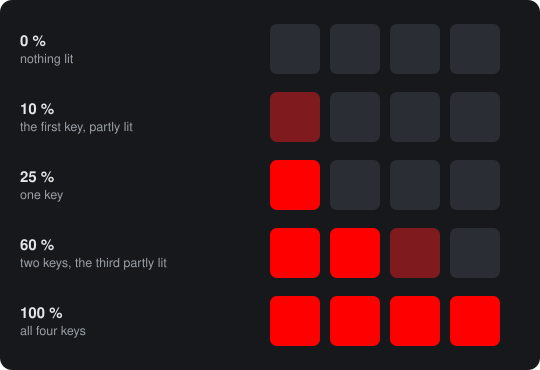
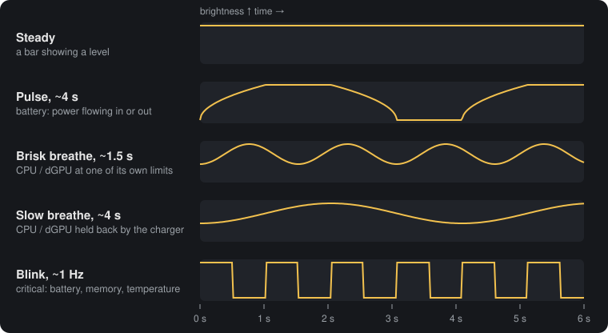
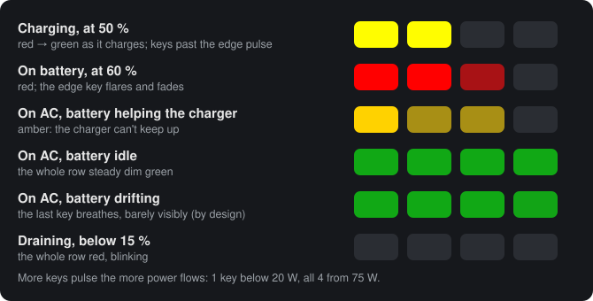
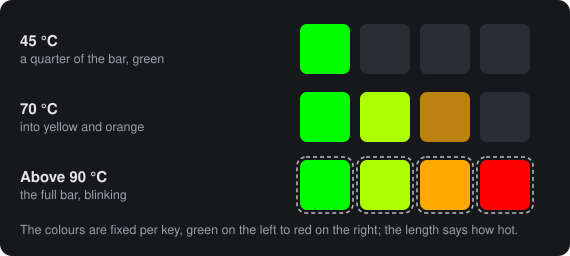

# 1. Reading the pad

[Manual](README.md) › Reading the pad

The macropad has 24 keys in four columns and six rows, and the top row's keys
are shorter than the rest. Fitted in the laptop, it sits to the right of the
keyboard, and its top row is the one nearest the screen. With the host
running, each row is a separate gauge.

## How a bar reads

Every row except the battery's idle state is a **bar of four keys** that
fills from the left. The full row is 100 %, so each key stands for 25 %. The
key at the bar's edge lights partly, in proportion to the remainder. At 60 %,
two keys are fully lit and the third is lit at less than half.

A few things make the bars easy on the eye:

- **They glide.** When a value changes, the bar slides to it over about 0.3 s
  instead of jumping. The host sends new values every 0.4 s, so the bars move
  smoothly.
- **A partly lit key stays visible.** At low brightness, LEDs show nothing
  below a certain level. The firmware lifts a partly lit key just enough to
  be seen, so it can look a little brighter than its share.
- **Colours are per row**, so you can tell the rows apart at a glance: red for
  the CPU and iGPU, gold for memory, green for the dGPU, and a fixed
  green-to-red gradient for temperature. The battery's colour carries meaning
  of its own (see below).

## Brightness follows your screen

The pad dims and brightens with the laptop's built-in screen, within about
half a second of a change. It never goes as bright as the LEDs can: full LED
brightness is glaring next to a screen. The mapping, all adjustable in the
`[cli]` section of [`sysmon.ini`](06-settings.md#command-line-defaults-cli):

| Option | Default | Meaning |
|--------|---------|---------|
| `max-led` | 150 | Pad brightness (0-255) at 100 % screen brightness |
| `min-led` | 8 | Pad brightness at 0 % screen brightness |
| `led-gamma` | 2.0 | Curve between the two. Higher keeps the pad dimmer through the middle range, and 1.0 is a straight line. |
| `fallback-brightness` | 30 | Screen brightness (%) assumed when Windows can't report it, for example with only an external monitor in use |

The boot rainbow and the regular RGB effect don't follow the screen. The
rainbow has a fixed, dim brightness. The regular effect uses its own
brightness, which you set with the keys or VIA (see
[Keys and lighting](04-keys-and-lighting.md)).

## The rhythms

Rows move in five distinct ways, and each one means something different:

| Rhythm | Looks like | Means |
|--------|------------|-------|
| **Steady** | A plain bar | A reading, nothing more |
| **Pulse** (~4 s) | Keys at the bar's edge swell, hold, fade and rest dark | Battery only: power flowing in (charging) or out (draining) |
| **Brisk breathe** (~1.5 s) | The whole row swells and dims, but never goes dark | The CPU or dGPU is at one of its own limits |
| **Slow breathe** (~4 s) | The same, slower | The CPU or dGPU is held back because the charger can't supply enough power |
| **Blink** (~1 Hz) | The whole row on and fully off, once a second | **Critical**: battery draining below 15 %, memory at 90 %+, temperature above 90 °C |

The rule of thumb: **blinking means act now, breathing means "for your
information"**. A breathing row dips only to about 40 % brightness, so the
bar stays readable.

## Row 1: battery

| State | How it looks |
|-------|--------------|
| **Charging** | A bar of the charge level. Its colour runs from red when nearly empty, through yellow, to green when full. The edge key and the keys to its right **pulse**, like charge flowing in. |
| **On battery** (unplugged) | A **red** bar of the charge level. The edge key and the keys to its left **flare and fade**, like charge draining out. |
| **On AC, battery helping** | The same draining look in **amber**. The charger is plugged in but can't cover what the laptop draws, so the battery makes up at least 10 W. Typical with a low-power USB-C charger or a monitor's USB-C port. The CPU or dGPU row usually [breathes slowly](02-limits-and-messages.md#brisk-or-slow) at the same time. |
| **On AC, idle** | The **whole row steady dim green**. The battery is full, or held at its charge limit, and nothing flows. A drain under 10 W on AC also counts as idle: that's the embedded controller managing the battery around its charge limit, not a real shortage. |
| **On AC, drifting** | The idle green row with **its last key breathing very faintly**, easy to miss by design. The battery is drifting a little below its charge limit. It's harmless. The figure above exaggerates the breathing so you can see it. |
| **Critical** | The **whole row red, blinking**. The battery is below 15 % (`BATT_CRITICAL_PCT`) and draining: on battery, or on AC with the battery helping. |

**How many keys pulse** shows how much power is flowing: one key below 20 W,
two from 20 W, three from 45 W and all four from 75 W (`RATE_SEG_W1` to
`RATE_SEG_W3`).

**The bar is scaled to your charge limit.** If you set the laptop to stop
charging at 80 %, a battery at 80 % shows a **full** bar, so "full" always
means "as full as it's going to get". The limit is read from the embedded
controller through `framework_tool`. Without `framework_tool` installed, the
bar is scaled to 100 %. The critical blink is based on the real percentage,
not the scaled one.

## Row 2: CPU

A **red** bar of total CPU usage across all cores: the share of time the
cores were busy. Task Manager computes its CPU figure differently (it
accounts for clock speed), so the two can disagree, especially while the
processor boosts.

The row **breathes** when a limit holds the processor back: a power budget, a
current limit, its temperature limit, or a clock held at base. On the AMD
Ryzen in the Framework 16, this row stands for the whole APU (CPU cores and
iGPU together), because the limits apply to the whole chip. The pad also
scrolls the limit's name across. See
[Limits and messages](02-limits-and-messages.md).

## Row 3: memory

A **gold** bar of the memory in use, as a percentage of installed RAM. At
**90 % or more** (`MEM_CRITICAL_PCT`) the whole row **blinks**. Windows will
soon start paging heavily, or programs may fail to get memory.

## Row 4: iGPU and NPU

The **iGPU** (the Radeon graphics built into the processor) is a **red** bar.
It measures the GPU's 3D engine, the same figure as the "3D" graph in Task
Manager's GPU page, which games and most drawing use. Video playback mostly
uses the separate video engine, so it moves this bar little.

The **NPU** (the AI engine on Ryzen AI processors) shares this row instead of
having its own, because it sits on the same chip and is idle most of the
time. It's drawn as a **dim cyan bar behind** the red one:

- NPU idle: you see just the iGPU's red bar.
- NPU busier than the iGPU: cyan keys extend past the end of the red bar, up
  to the NPU's level.
- iGPU busier than the NPU: the cyan is hidden behind the red.

A key that both bars only partly cover mixes the two colours. On a machine
without an NPU, the row is just the iGPU bar.

## Row 5: dGPU

The **dGPU** (the discrete graphics card in the expansion bay) is a **green**
bar of its usage. On NVIDIA cards the figure comes from the NVIDIA driver,
the same one `nvidia-smi` shows. It counts all of the card's engines (3D,
compute, video encoding, copying). Without the NVIDIA driver, it comes from
Windows' 3D engine counter, like the iGPU row.

Like the CPU row, it **breathes** when a limit holds the card back: its power
limit, the hardware power brake, or thermal slowdown. See
[Limits and messages](02-limits-and-messages.md).

### The dGPU sleep marker

On a laptop with switchable graphics, the dGPU powers itself off completely
when nothing uses it. This state is called **D3cold**. It saves several
watts, so it's worth knowing whether it happens. While the dGPU is off, the
row's **last (right) key glows dim teal**. The longer it stays off without a
break, the further the teal grows to the left:

- On the way to off, the card first drops to a **light sleep (D3hot)**
  within a second of going idle: it's asleep, but its connection (the PCIe
  link) is still up, so it saves less. The last key glows **dim orange**.
- The connection powers down 6 to 8 seconds later. Only then does the card
  count as off, and the key turns teal.
- One more key lights after 15, 30 and 45 minutes off (`DGPU_OFF_STEP_S`).
  It stays at four keys after that.
- **Any wake, even a second long, fades the marker out.** Once the card is
  off again, the count starts over from one key. Windows and some apps wake
  the dGPU briefly now and then, and the marker shows those wakes too.
- Time nobody watched doesn't count. If the laptop sleeps, or the host
  restarts, the count starts over. The host itself wakes the dGPU for a
  couple of seconds when it starts.

The two colours count apart. Light sleep grows in orange the same way, one
more key per 15 minutes, but going from light sleep to off starts the bar
again at one teal key. So teal always means "fully off for this long".

Reading the power state never wakes the card. It comes from Windows' device
manager (the device's *Power data*), not from the GPU.

A full four-key teal marker means the dGPU hasn't woken for at least 45
minutes. That's the best case for battery life. A marker that keeps
restarting from one key means something wakes the dGPU regularly. A marker
that never appears means something keeps it awake: a browser or game using
it, an external monitor wired to the dGPU's port, or an overlay. An **orange
bar that keeps growing** means the card is asleep but something keeps its
connection up, so it never powers off.

On a laptop without a dGPU, row 5 stays dark.

## Row 6: temperature

The processor's temperature as a bar from **30 °C (empty) to 90 °C (full)**
(`TEMP_MIN_C`, `TEMP_MAX_C`). The colours are **fixed per key**, green on
the left through yellow and orange to red on the right. A longer bar reaches
further into the red.

Above **90 °C** (`TEMP_CRITICAL_C`) the whole row **blinks**. Mobile Ryzen
processors run up to their limit (100 °C on the Ryzen AI 9 HX 370) by
design, so short spells in the high 80s under load are normal. Long periods
of blinking at moderate load suggest a cooling problem, such as a blocked
vent or dust.

A CPU slowed down by its temperature limit also **breathes the CPU row** and
is named `CPU HOT`. The temperature row says how hot it is. The CPU row says
whether that's costing performance.

The temperature comes from the best source available. In order of
preference: LibreHardwareMonitor's sensors, the laptop's embedded controller
via `framework_tool`, the processor's own reading via ryzenadj, and as a last
resort Windows' ACPI thermal zone. The ACPI zone is frozen on the Framework
16, so its value never changes. If no source works, the row stays dark. The
[self-test](05-the-host-program.md#self-test) shows what every source reads
and which one is used.

---

Next: [2. Limits and messages](02-limits-and-messages.md)
