# 2. Limits and messages

[Manual](README.md) › Limits and messages

A modern laptop processor almost never runs as fast as it could. It runs
inside a set of **limits**: power budgets, current limits, a temperature
limit. When it reaches one, it slows down just enough to stay under it. The
same goes for the dGPU. This is normal and by design, but it's invisible, and
it explains why a game or a build runs slower than expected. The pad makes it
visible.

## A breathing row

When a limit holds the processor back, the **CPU row (row 2) breathes**. When
one holds the dGPU back, the **dGPU row (row 5) breathes**. The bar stays
visible and keeps showing usage, but the whole row swells and dims. It never
goes dark, since going dark is the critical blink's job.

### Brisk or slow

The pace tells you what kind of limit it is:

- **Brisk breathe, about 1.5 s per breath.** The chip is at one of **its own
  limits**: a power budget, a current limit, its temperature limit, or its
  clock held at base. The pad also names which one (see below).
- **Slow breathe, about 4 s per breath.** The **power supply** is the
  bottleneck. You're on AC, but the charger can't deliver what the laptop
  draws, so the battery is helping, and the component is being held back to
  fit. The battery row turns **amber** at the same time. Together they read
  as "the charger is overloaded, and this is the component it's choking". The
  usual cause is a low-power USB-C charger, or a monitor's USB-C port, instead
  of the Framework charger.

A limit that comes and goes quickly doesn't make the row flicker. Once a row
breathes, it keeps breathing until the limit has been clear for 8 seconds
(`LIMIT_RELEASE_S`).

## The limits

### Processor (CPU row)

The CPU row stands for the whole APU, meaning the CPU cores and the iGPU,
because the limits apply to the chip as a whole.

| Name on the pad | What it is | Kind |
|-----------------|------------|------|
| `STAPM` | **Sustained power budget.** AMD's long-term power limit, managed with the chassis (skin) temperature in mind, so it moves: it lowers as the laptop warms and rises again as it cools. The most common limit. | power |
| `PPT` | **Slow package power limit.** The sustained limit on the whole chip's power. | power |
| `FAST PPT` | **Fast package power limit.** The short boost window. Ignored by default, because it binds in short bursts and would make the row flicker. Add `fast` to `APU_LIMIT_SIGNALS` to include it. | power |
| `TDC` / `SOC TDC` | **Sustained current limit** of the CPU cores / the SoC part of the chip. | current |
| `EDC` / `SOC EDC` | **Peak current limit** of the cores / the SoC. | current |
| `HOT` | **Temperature limit.** The processor is within 3 °C of its thermal limit (100 °C on the Ryzen AI 9 HX 370) and slows to stay below it. | thermal |
| `CLK LIMITED` | **Held at base clock.** The cores are busy but never boost above their base clock, and none of the limits above is near. Boost has been switched off. On the Framework 16 this happens, for example, when the laptop runs from a low-power USB-C source with the battery helping. | clock |
| `CHARGER` | **Held back by the charger.** One of the limits above binds, or the clock is held, while the battery helps an overloaded charger. Shown as the **slow** breathe. | charger |
| `POWER` | Package power at its ceiling, inferred without ryzenadj (see [Where the readings come from](#where-the-readings-come-from)) | power |

The power and clock limits only count **on AC**. On battery, the processor's
limits drop by design to save energy. That's expected, and the battery row
already tells you you're on battery.

### dGPU (dGPU row)

| Name on the pad | What it is | Kind |
|-----------------|------------|------|
| `POWER` | The card is at its **power limit** (drawing at least 92 % of the limit the driver enforces) | power |
| `BRAKE` | The **hardware power brake**: the system told the card to cut power right now, for example because the power supply is overloaded | power |
| `HOT` | **Thermal slowdown**: the card slows down because it is too hot | thermal |
| `CHARGER` | A busy card capped while the battery helps an overloaded charger. Shown as the slow breathe. | charger |

These need the NVIDIA driver. An AMD dGPU still shows its usage, but not its
limits.

## The pad names the limit

The brisk breathe tells you *that* a limit binds, not *which* one, so the pad
spells it out. When a limit has held for **3 seconds** and still holds:

1. The bars dim out (0.3 s).
2. A line of text scrolls across the pad from right to left, in the row's
   colour: red for the CPU, green for the dGPU. It says which component,
   which limit, and the limit's value right now.
3. The bars fade back in. They kept running underneath, so they come back
   showing current readings.

A message takes about 9.5 seconds for `CPU STAPM 28W`. Examples:

| Message | Meaning |
|---------|---------|
| `CPU STAPM 28W` | The sustained power budget holds the processor back. The budget is 28 W right now. It moves, falling as the chassis warms. |
| `CPU PPT 30W` | The slow package power limit, 30 W |
| `CPU FAST PPT 45W` | The fast package power limit (only if enabled) |
| `CPU TDC 54A` / `CPU SOC TDC 30A` | Sustained current limit, cores / SoC |
| `CPU EDC 54A` / `CPU SOC EDC 30A` | Peak current limit, cores / SoC |
| `CPU HOT 100C` | At the temperature limit, which is 100 °C |
| `CPU CLK LIMITED 2GHZ` | Held at base clock. The number is the busy cores' fastest clock, for example `2.6GHZ`. |
| `GPU POWER 100W` | The dGPU at its power limit, 100 W |
| `GPU BRAKE` | The dGPU's hardware power brake |
| `GPU HOT 87C` | The dGPU slowing down because of heat, now at 87 °C |
| `CPU POWER 54W` | Package power at its ceiling (only without ryzenadj) |

When several limits bind at once, the pad names the one **closest to its
limit**, and keeps naming that one while it holds.

### How often

A message plays **once per episode**, so a limit that holds for an hour
doesn't scroll every few seconds:

- It plays again only if **the limit changes** (STAPM gives way to TDC, say),
  and not more often than every **30 seconds** per component
  (`MSG_MIN_GAP_S`).
- An episode ends once the component has been free of limits for
  **2 minutes** (`MSG_REARM_S`). The next limit after that is a new episode
  and gets named again.
- The slow charger breathe isn't named on its own. With the amber battery
  row next to it, it's clear enough. You can still ask for it with the replay
  key.

A message never plays over the boot rainbow or the disconnect warning. It
waits for the bars to be back and settled. If the pad goes dark (lights off,
or the laptop sleeps) or the host stops before a message plays, the message
is dropped, not saved up. The host names that limit again later if it still
holds.

Every message sent is written to the log, `C:\ProgramData\FW16Sysmon\sysmon.log`,
as a line like `Message to the pad: CPU STAPM 28W`.

## Asking: the replay key

To ask what holds things back **right now**, turn **NumLock off** and press
**keypad 5**, the second key of the fourth row. The pad answers with a
message for each row that's breathing, the charger included (`CPU CHARGER`,
in amber), or says **`NO LIMIT`**.

The key only works this way while the host is running and the pad is lit.
Then the pad keeps the key press to itself, so Windows doesn't receive it.
(With NumLock off, keypad 5 would send "Clear", which does nothing useful.)
Otherwise it's an ordinary keypad 5. With NumLock on, it always types `5`.

## Changing what breathes and what gets named

All of this is set in [`sysmon.ini`](06-settings.md), in the `[power_limits]`
and `[messages]` sections:

- `LIMIT_KINDS` sets which kinds of limit make a row breathe. The default is
  all five: `power, current, thermal, clock, charger`. `none` turns
  breathing off.
- `MSG_KINDS` sets which kinds the pad names on its own. The default is
  `power, current, thermal, clock`.
- `MSG_ENABLE = 0` turns automatic messages off and keeps only the replay
  key.
- `MSG_SPEED`, `MSG_SHOW_VALUE`, the timings, and every word on the pad
  (`MSG_WORD_STAPM = STAPM`, and so on) can all be changed. See
  [Settings recipes](06-settings.md#recipes).

## Where the readings come from

| Component | Source | Needs |
|-----------|--------|-------|
| AMD processor (STAPM, PPT, TDC, EDC, HOT) | The processor's own power table (the AMD SMU), read through **ryzenadj**. This is the source tools like HWiNFO use for "APU STAPM Limit". A limit counts as binding once its live value reaches 95 % of the limit (`APU_LIMIT_NEAR`). | A kernel driver (WinRing0) that Windows blocks when **Memory Integrity** is on. See [FAQ](10-faq-and-glossary.md#memory-integrity). |
| Processor without ryzenadj | An estimate from LibreHardwareMonitor's package power reading: under sustained load on AC, power that plateaus at its ceiling counts as `POWER`. It can't tell which limit it is. | The same driver |
| Clock held at base | Windows' own per-core clock and load counters. | Nothing extra |
| NVIDIA dGPU | The NVIDIA driver's own throttle reasons (NVML). Each must hold for 3 readings (`NV_DEBOUNCE_READS`). | The NVIDIA driver |

If ryzenadj can't load, for example because Memory Integrity is on, the CPU
row can still breathe for the clock limit. It just can't name power or
current limits. The [self-test](05-the-host-program.md#self-test) says which
sources work.

## What to make of it

- **STAPM is normal.** It's how the laptop keeps its chassis comfortable to
  touch. On a cool laptop it may barely bind, and on a warm one under long
  loads it binds a lot. Its value is in the message, so you can watch it move.
- **`CLK LIMITED` usually means the charger.** Boost switched off with no
  other limit in sight is what a weak USB-C power source does. Plug in the
  Framework charger.
- **`HOT` while plugged in, under moderate load,** may mean cooling trouble,
  such as dust or a blocked vent, or a laptop on a soft surface.
- **Amber battery and a slow breathe** means the charger is too small for
  what you're doing.
- For the long-term picture (how often, for how long, on which power source
  and in which Windows power mode), see [The limit log](07-limit-log.md).

---

Previous: [1. Reading the pad](01-reading-the-pad.md) · Next: [3. What the pad shows, and when](03-what-the-pad-shows-when.md)
