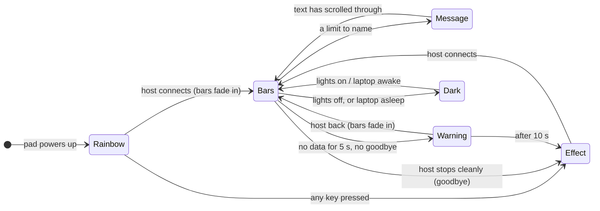
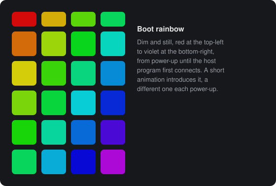
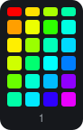
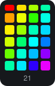
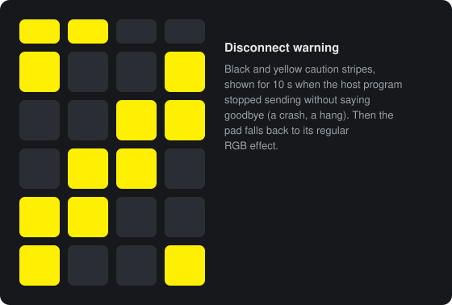

# 3. What the pad shows, and when

[Manual](README.md) › What the pad shows, and when

Besides the bars, the pad has a handful of other displays. Which one you see
depends on whether the host program is talking to the pad, and on how it
stopped if it isn't.

| Display | When |
|---------|------|
| **Boot rainbow** | From power-up until the host first connects |
| **Bars** | While the host is sending data, which is normal operation |
| **Message** | A limit is being named. It replaces the bars for about 10 s. |
| **Disconnect warning** | The host stopped sending without a goodbye. Shown for 10 s. |
| **Regular RGB effect** | The host isn't running: it stopped cleanly, or after the warning |
| **Dark** | The lights are switched off, or the laptop is asleep |

## Power-up: the boot rainbow

Whenever the pad gets power (the laptop starts, or the module is inserted), it
shows a dim, still **rainbow**. It runs diagonally
from red at the top-left key to violet at the bottom-right one. A short
**animation** introduces it.

The rainbow stays until the host program connects. The service starts with
Windows, so that's normally around the time the sign-in screen appears. Then
the bars **fade in over the rainbow**, each key going straight from its
rainbow colour to its bar colour. If the host connects while the animation is
still playing, the animation finishes first.

**Pressing any key** dismisses the rainbow, and cuts the animation short if it
is still playing. Until the host connects, the pad then shows its regular RGB
effect.

The rainbow belongs to power-up only. If the host stops later, the pad shows
the regular effect (or first the warning), never the rainbow again until the
next power-up.

### The animations

Each power-up picks one of 22 animations. The pick works like a shuffled deck:
over 22 power-ups you see every animation once, in a random order, and never
the same one twice in a row. The random details (where sparks land, how the
fire flickers) are new every time.

Here they all are, numbered as in the table below, each as the pad plays it:

| # | Animation | What happens |
|---|-----------|--------------|
| 1 | Wipe | A soft diagonal edge sweeps from the top-left corner, revealing the rainbow |
| 2 | Shine | The same sweep with a white edge that cools into the colours |
| 3 | Spin | The rainbow flows along the diagonal, slows down and freezes |
| 4 | Bloom | The pad fades in white, then the colours fade in |
| 5 | Twinkle | Keys ignite as white sparks, roughly along the diagonal |
| 6 | Rotate | The gradient spins around the centre and settles on the diagonal |
| 7 | Twinkle, scatter | Sparks land anywhere, in random order |
| 8 | Fire | Flames climb from the bottom row with embers shooting ahead, and the burned keys cool into the rainbow |
| 9 | Converge | Ragged white edges from opposite corners meet in the middle |
| 10 | Flicker | Each key sputters on like a warming neon tube |
| 11 | Lock-in | The whole pad sweeps through the spectrum as one colour, and each key freezes as it reaches its own |
| 12 | Fireworks | Rockets rise and burst, lighting the keys around them, and a finale lights the rest |
| 13 | Lightning | Jagged bolts strike with a flickering sky flash, and the last one lights everything |
| 14 | Stack | Colours drop in like falling blocks, bottom row first |
| 15 | Spotlight | A spotlight wanders the dark pad, then widens to light it all |
| 16 | Glitch | The picture starts up like a corrupted video signal until it holds clean |
| 17 | FW16 pop | F, W, 1 and 6 pop up one at a time as big letters, then the rest sparkles in |
| 18 | FW16 scroll | "FW16" scrolls through like an LED ticker, then the rainbow slides in |
| 19 | FRAMEWORK scroll | The same with "FRAMEWORK", at an easy reading pace (about 9 s) |
| 20 | FRAMEWORK flash | White letters flash one at a time like a sign spelling itself out, then the rainbow sputters on |
| 21 | FRAMEWORK scroll, letter colours | Each letter keeps its own colour as it moves |
| 22 | FRAMEWORK16 scroll, letter colours | The same with "FRAMEWORK16" (about 10.5 s) |

Most animations take 2 to 3 seconds. The scrolling text ones take up to
10.5 s.

## Normal operation: the bars

While the host sends data, the pad shows the [bars](01-reading-the-pad.md).
Now and then a [message](02-limits-and-messages.md#the-pad-names-the-limit)
takes over for about 10 seconds, then the bars return.

## When the host stops

How the pad reacts depends on *how* the host stopped:

**It stopped on purpose.** Examples: Windows shutting down or restarting, the
service being stopped or restarted, or a console run ended with Ctrl+C. The
host sends a **goodbye**, and the pad switches to its **regular RGB effect**
at once.

**It vanished.** Examples: a crash, a killed or hung process, or the laptop
losing power. After **5 seconds** without data (`TIMEOUT_MS_DEFAULT`), the
pad shows the **disconnect warning**, black and yellow caution stripes, for
**10 seconds**. Then it falls back to the regular RGB effect. If the host
comes back during the warning, the bars fade back in.

The warning exists to be noticed. A pad that silently stops being a monitor
looks just like one showing an idle system. If you see the stripes, the host
had a problem. The [log](05-the-host-program.md#the-log) usually says what.

**The laptop went to sleep.** No warning. The pad is switched off while the
laptop sleeps, and silence across a sleep is expected. When the laptop wakes,
the pad comes back, and the host reconnects within a few seconds.

When the host starts again (a service restart, say), the bars return: they
fade in from the warning, or cut in from the regular effect.

## Lights off

With **NumLock off**, the **top-left key** switches all the pad's lights off,
bars included, and switches them back on. VIA's "All Off" does the same. The
pad remembers the setting across restarts and power-ups. While it's dark:

- the host keeps running and keeps recording the
  [limit log](07-limit-log.md);
- limit messages that come due are dropped, not saved up for later;
- the boot animation doesn't play at power-up;
- the log notes it (`The macropad's RGB lighting is switched off ...`), and
  so does the [self-test](05-the-host-program.md#self-test).

The **next effect** and **previous effect** keys also switch the lights back
on. See [Keys and lighting](04-keys-and-lighting.md).

## The regular RGB effect

When the host isn't running, the pad behaves like an ordinary RGB macropad.
It shows whatever effect is set: rainbow swirl, breathing, reactive, and so
on. You choose it with the lighting keys (NumLock off) or in VIA, and the pad
remembers it. The effect has its own brightness, hue, saturation and speed,
and none of them affect the bars.

A calm, dim effect is the best choice, since you'll see it whenever the host
isn't running. After a reset of its settings, the pad starts with a dim blue
breathing effect.

## Moving parts

- **Removing and reinserting the module** is a power-up for the pad: the boot
  rainbow, a new animation, and the host picks the pad up again within about
  5 seconds.
- **Flashing new firmware** restarts the pad the same way. See
  [Flashing](09-install-update-remove.md#flashing-the-firmware).
- **Without the host at all** (another operating system, the BIOS setup, a
  laptop without the program), the pad shows the rainbow from power-up until
  a key is pressed, then the regular effect. It works as a normal keypad
  throughout.

---

Previous: [2. Limits and messages](02-limits-and-messages.md) · Next: [4. Keys and lighting controls](04-keys-and-lighting.md)
