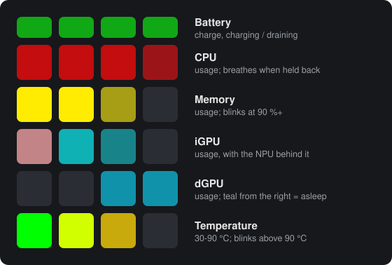

# FW16 Macropad Sysmon: user manual

This manual covers the **Framework Laptop 16 RGB Macropad** when it runs the
**sysmon firmware** and the **FW16 Macropad Sysmon** program is installed on
Windows. With both in place, the macropad's 24 keys become a live system
monitor. Each of its six rows is a bar graph: battery, CPU, memory, iGPU (with
the NPU), dGPU and temperature. The pad also tells you when something holds
your CPU or GPU back, and names what it is.

Two parts work together:

- **The firmware** runs on the macropad. It only draws. It holds no opinions
  about what a reading means.
- **The host program** (the Windows service `FW16Sysmon`) does the measuring
  and deciding. It reads the sensors, decides what every row should show, and
  sends the pad a description about 2.5 times a second. Every threshold,
  colour and timing lives in a settings file on the laptop, so you can change
  how the pad behaves without touching the firmware.

> **Version.** Written for this branch as of November 2026: host 1.0.0, and
> the firmware built alongside it. Every build so far calls itself 1.0.0, so
> the version number alone doesn't tell builds apart. The
> [self-test](05-the-host-program.md#self-test) flags firmware from before the
> current host protocol, but not every later addition. Where a feature needs
> recent firmware, the manual says so. Flashing the firmware that came with
> your host (Start menu → *Flash firmware onto the macropad*) always brings
> the pad up to date.

## The pad at a glance

| Row | Shows | Normal look | When it needs your attention |
|-----|-------|-------------|------------------------------|
| 1 (short keys) | **Battery** | Charging: a bar that turns from red to green as it fills, with the keys past its edge pulsing. On battery: a red bar whose edge flares and fades. On AC with the battery idle: the whole row steady dim green. | The whole row **blinks red** below 15 % while draining. **Amber** means you're on AC but the charger can't keep up, so the battery is helping. |
| 2 | **CPU** usage | Red bar | **Breathes** while a limit holds the CPU back (briskly: one of its own limits; slowly: a weak charger). |
| 3 | **Memory** usage | Gold bar | The whole row **blinks** at 90 % and above. |
| 4 | **iGPU** usage, with the **NPU** | Red bar for the iGPU, dim cyan behind it for the NPU | n/a |
| 5 | **dGPU** usage | Green bar. **Dim teal keys from the right** mean the dGPU is powered off, one more key for every 15 minutes it stays off. | Breathes like the CPU row. |
| 6 | **Temperature** (CPU) | Bar from 30 °C (empty) to 90 °C (full), green keys on the left to red on the right | The whole row **blinks** above 90 °C. |

Other things the pad can show:

| You see | It means |
|---------|----------|
| **Text scrolling** across the pad (`CPU STAPM 28W`) | A limit is holding the CPU or dGPU back, and the pad is naming it. See [Limits and messages](02-limits-and-messages.md). |
| A dim **rainbow**, often after a short animation | The pad has just powered up and the host program hasn't connected yet. |
| **Yellow and black stripes** | The host program stopped without saying goodbye, for example a crash. After 10 s the pad switches to its regular effect. |
| The **regular RGB effect** (whatever you set up in VIA or with the keys) | The host program isn't running. It was stopped, or the laptop is shutting down. |
| **Nothing at all** | The lights are switched off (see below), or the laptop is asleep. |

Two keys worth remembering, both with **NumLock off**:

- **Top-left key**: switches all the lights on or off, bars included, when
  released. Holding it for a second instead saves a diagnostic trace, and
  the pad flashes white.
- **Keypad 5** (fourth row, second key): asks the pad to say what limits the
  CPU and dGPU right now, or `NO LIMIT`.

## Contents

1. [Reading the pad](01-reading-the-pad.md): every row in detail, how a bar
   reads, the brightness, and the rhythms (pulse, breathe, blink).
2. [Limits and messages](02-limits-and-messages.md): why a row breathes,
   what the scrolling text means, the keypad 5 replay key.
3. [What the pad shows, and when](03-what-the-pad-shows-when.md): power-up,
   the boot rainbow and its 22 animations, sleep, shutdown, crashes, lights
   off.
4. [Keys and lighting controls](04-keys-and-lighting.md): both key layers, the
   RGB controls, VIA.
5. [The host program](05-the-host-program.md): the service, the Start menu
   items, files, the live view, the log, the command line.
6. [Settings](06-settings.md): editing `sysmon.ini`, recipes for common
   changes, and every setting with its default.
7. [The limit log](07-limit-log.md): the long-term record of what held the
   CPU and dGPU back, and how to read its report.
8. [Troubleshooting](08-troubleshooting.md): symptoms and fixes, the self-test
   line by line, log messages.
9. [Installing, updating, flashing, removing](09-install-update-remove.md).
10. [FAQ, limitations and glossary](10-faq-and-glossary.md).

## Conventions

- **Rows** are numbered 1 to 6 from the top, the top being the edge nearest
  the screen. Row 1 is the row of short keys. **Keys** in a row are counted
  from the left. A bar always fills from the left.
- **The host** means the FW16 Macropad Sysmon program on the laptop, normally
  running as the `FW16Sysmon` service.
- Paths assume the default install: the program in
  `C:\Program Files\FW16 Macropad Sysmon\`, its settings, log and limit log in
  `C:\ProgramData\FW16Sysmon\`.
- Setting names such as `MEM_CRITICAL_PCT` are entries in `sysmon.ini`. See
  [Settings](06-settings.md).
- The figures are schematic. They show which keys light, and roughly in what
  colour. Real LEDs look different from a screen: greens come out much
  stronger, and dim keys look dimmer.

## Beyond this manual

The technical reference for the firmware and host is the sysmon
[readme](../readme.md). It covers the wire protocol, building the firmware and
the installer, running the host from source, and the animation preview and LED
trace tools.

## Maintaining this manual

Three scripts keep it in step with the code. All are standard-library Python
3.8+, and none imports the host.

- [`img/figures.py`](img/figures.py) redraws the figures.
- [`tools/settings_tables.py`](tools/settings_tables.py) regenerates the
  settings and `[cli]` tables in [Settings](06-settings.md) from
  `host/config.py` and `host/fw16_sysmon.py`. Run it after adding or changing
  a setting.
- [`tools/check_manual.py`](tools/check_manual.py) checks that every link and
  anchor resolves, and that every setting, flag and Start-menu item named
  here exists in the sources.

Coding sessions don't update the manual as they go. A weekly catch-up job
reviews the commits made since the bookmark below, updates the chapters
they affect, moves the bookmark, and opens a pull request. The bookmark is
the last `macropad-sysmon` commit the manual reflects:

<!-- manual-synced-to: cb28343001 -->
